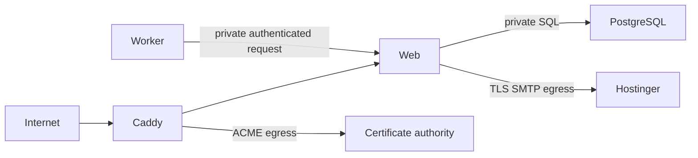

# 02 — Production architecture

The prepared self-hosted Compose topology uses Caddy for public HTTP/HTTPS ingress, a standalone Next.js web service, an email worker, a one-shot migration service, and private PostgreSQL 17. PostgreSQL has no published host port. The worker API is denied by the public Caddy route and is intended to be reachable only from the private application network.

Database and application networks are internal. The web service has a dedicated SMTP egress network because the current outbox processing runs in the web API process. Caddy has a separate certificate egress network for ACME. Docker networks do not enforce destination-specific egress; configure the host firewall to limit SMTP egress and certificate-provider traffic. CDN proxy trust and client-IP forwarding must be set up before adding a CDN.

This Compose file implements the bundled private-PostgreSQL option. A managed database requires a separately reviewed Compose/provider configuration, TLS policy, firewall allowlist, and migrator grants; the current production preflight expects the private `postgres` service. The Compose file was validated but not started.

