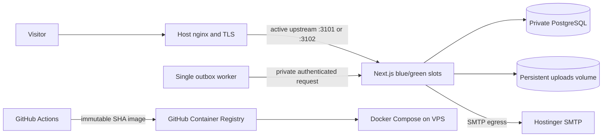

# Production architecture

The live-site review supplied by the owner reports an HTTP response served through nginx. The owner confirmed nginx is installed on the host and the app runs in Docker/Compose. This repository's production stack is aligned to that edge: nginx remains the public TLS proxy and forwards to one of two app containers bound to localhost ports 3101 and 3102.

The blue-green release procedure starts the inactive Next.js slot, checks its database-backed health endpoint, switches the nginx upstream, reloads nginx, checks the public health route, then points the sole email worker at the new slot. The previous slot remains running for rollback. PostgreSQL is private to Docker networks; the host nginx is the only public ingress. SMTP egress is limited to the app service's dedicated Docker network, subject to host firewall rules.

The topology also includes a one-shot migration service and persistent PostgreSQL and uploads volumes. Migrations must remain compatible with both app versions while they overlap. The current site's database, uploads, nginx location, and VPS directory have not been inspected; the deployment must not be enabled until those are confirmed and any existing data is preserved or deliberately migrated.

This is the configured deployment design, not evidence of a live VPS deployment. GitHub Actions can publish an image after `main` changes; the remote deploy job stays disabled until the host, secrets, nginx upstream, and production GitHub environment are prepared. See [Deployment](../DEPLOYMENT.md).
